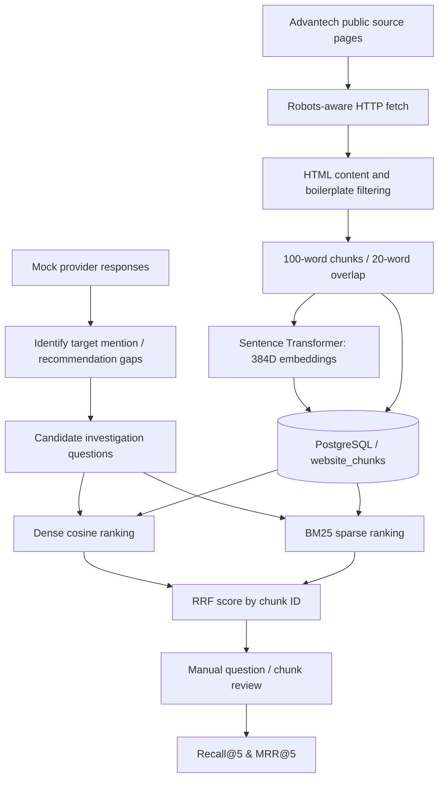

# Part 1 — Retrieval Research & Evaluation

## Objective

Explore three strategies for retrieving relevant industrial-IoT technical evidence given questions derived from *synthetic* provider-response visibility gaps. The evaluation concerns **document retrieval**, not real AI-provider search exposure or truth of the synthetic response labels.

## Research workflow

## Storage and retrieval

- `website_chunks` stores brand, source URL/title, chunk index, content, timestamp and a `VECTOR(384)` embedding (plus provenance fields where initialized).
- `all-MiniLM-L6-v2` creates normalized embeddings in Python; **pgvector stores and searches them; it does not encode text**.
- `embedding <=> query_vector` gives *cosine distance* (lower is closer). `1 - distance` is *cosine similarity* (higher is closer).
- BM25 uses term-frequency saturation, inverse document-frequency, and length normalization. The basic tokenizer can under-handle domain identifiers such as `UNO-2484G`.
- RRF: `score(d) = Σ_m 1/(60 + rank_m(d))`, with ranks per retriever and stable document IDs. It avoids mixing cosine and BM25 scores on incompatible scales.

## Notebook visualizations

- Chunk overlap/length: check whether windows become too repetitive or too sparse.
- PCA embedding projection: exploratory 2D visualization only; it does not preserve all 384D distances.
- Question-to-chunk similarity heatmap: directly displays full-dimensional cosine similarities.
- Chunks-per-URL and extracted-content diagnostics: surface navigation/menu pollution and source imbalance.
- Retrieval and evaluation comparison plots: compare ranks and Recall@5/MRR@5, with distinct score semantics.

## Evaluation data and procedure

1. Ingest the corpus and record its provenance (live page extraction versus offline fixtures).
2. Open `data/advantech_retrieval_eval_questions.json`; it contains 16 questions with **source and term hints**, not verified relevant chunk IDs.
3. Generate `data/advantech_chunk_judgments_review.csv` from the notebook. This file is not overwritten automatically once present; back up labels before changing the corpus.
4. Read the *complete* chunk text for each question–chunk pair. Set `relevant=1` only when evidence actually supports answering the question; otherwise `0`. Source URL or shared tokens alone are insufficient.
5. Set `USE_SILVER_DEMO=False` in the evaluation section and rerun. Keep corpus/questions/candidate counts fixed across dense, BM25, and hybrid.
6. Inspect question-level misses, false positives, URL coverage, and exact product-ID performance—not only averages.

**Recall@5** = `|relevant chunks among retrieved top five| / |all judged relevant chunks|`. **MRR@5** is the mean of `1 / first relevant rank`, or 0 if absent from the first five. Queries with no labeled relevant chunk require a separate *no-answer/abstention* test; do not interpret skipped queries as successes.

**Data limitation:** Automatic `silver_relevant` hints are lexical heuristics, *not independently validated ground truth*. A small corpus with incomplete labels cannot establish that one retriever is generally superior. Evaluate on larger, more varied permitted documents with independent manual judgments before reporting comparative accuracy.

## Reproducibility and boundaries

Start/reuse the PostgreSQL container, execute notebook from the repository root, and record model/corpus versions. The offline fixture passages are curated paraphrases and must never be described as scraped website evidence. Re-ingestion with delete/insert can change numeric primary keys and invalidate previous chunk judgments. Future work: stable content hashes, a persistent BM25 index, improved domain tokenization, no-answer metrics, and more independent relevance judgments.
